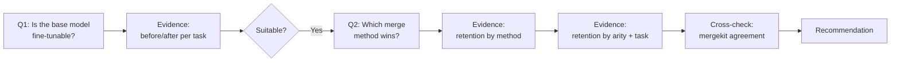

# Findings: Is Qwen2.5-1.5B-Instruct Suitable for Fine-Tuning + Merging, and Which Method Wins?

This is the recommendation report. It does not propose new training — it reads
the evidence already produced by this pipeline (`analysis/*.csv`,
`results/*.json`) and answers the two questions the project set out to answer.

## Flow of this report



---

## Step 1 — Is the base model suitable for fine-tuning?

**Yes.** Every task improved sharply after LoRA fine-tuning, with no
catastrophic instability (no NaN losses, no collapsed outputs).

| Task | Metric | Base model | Fine-tuned specialist | Change |
|---|---|---|---|---|
| SQL | exact-match accuracy | 0.027 | 0.757 | **28x** |
| Math | exact-match accuracy | 0.563 | 0.643 | +14% |
| Translation (Ta→En) | chrF++ | 18.13 | 23.81 | +31% |
| JSON extraction | field F1 | 0.952 | 1.000 | +5% |

Training also converged cleanly for all four adapters (final losses: SQL
0.019, math 0.271, translation 1.84, JSON 7.5e-06) — none diverged, none
needed early stopping. A 1.5B model with r=16 LoRA on 7-8k examples was
enough to move SQL from "barely functional" to "usable," which is the
headline signal that this SLM responds well to fine-tuning at this scale.

**Verdict: the model is a good fit for fine-tuning.** It is not so small that
it can't absorb task-specific behavior, and not so large that fine-tuning
four separate adapters was impractical (each trained in well under an hour
on a single consumer GPU).

---

## Step 2 — Is it suitable for *merging* the resulting adapters?

**Yes, with caveats.** This is measured by retention:

```
R = score(merged model on task) / score(single-task specialist on that task)
```

R = 1.0 means the merge lost nothing relative to training a dedicated
adapter. Across all 101 merged models × their combo tasks (280 cells, main
grid + coefficient sweep), **mean retention never dropped below 0.94 for any
method**, and the best method averaged 0.99. That is a strong result — it
means combining up to 4 tasks into one adapter is usually nearly free.

The caveat: retention degrades as more tasks get merged together (see Step
4), and one task (SQL) is consistently the most fragile.

---

## Step 3 — Which merge method wins?

Ranked by mean retention across all 28 (combo × task) cells each method was
applied to:

| Rank | Method | Mean R | Median R | Worst case |
|---|---|---|---|---|
| 1 | **magnitude_prune** | **0.991** | 0.999 | 0.868 |
| 2 | dare_ties | 0.971 | 0.992 | 0.826 |
| 3 | linear | 0.968 | 0.995 | 0.718 |
| 4 | dare_linear | 0.960 | 0.977 | 0.661 |
| 5 | ties | 0.943 | 0.953 | 0.806 |

**magnitude_prune wins outright** — highest mean, highest median, and the
narrowest spread between best and worst case. It is also the method behind
the model we actually deployed
(`magnitude_prune__sql-math-translation-json`, 0.960 mean retention across
all 4 tasks).

`ties` is the weakest performer here — worth flagging since TIES is often
cited in merging literature as a strong default. Two things pull its score
down, both already documented in `merge_meta.json` for every ties/dare_ties
model: this PEFT implementation elects signs on the LoRA A/B factors
separately rather than on the composed weight delta, and its retention on
`translation` specifically is the worst of any method (0.835 mean vs. 0.94+
for the others) — TIES's sign-election appears to actively hurt this task.

---

## Step 4 — Where retention actually breaks down

**By how many tasks are merged together:**

| Method | 2 tasks | 3 tasks | 4 tasks |
|---|---|---|---|
| magnitude_prune | 1.003 | 0.988 | 0.960 |
| dare_ties | 0.992 | 0.960 | 0.943 |
| linear | 0.990 | 0.967 | 0.906 |
| dare_linear | 0.988 | 0.955 | 0.887 |
| ties | 0.968 | 0.932 | 0.906 |

Every method degrades monotonically as arity increases — merging is not
free, it is a real trade-off that gets more expensive with each additional
task. magnitude_prune degrades the *slowest*, which is a second, independent
reason to prefer it for a general-purpose (all-task) merge.

**By task, which one is hardest to preserve:**

| Task | Best method (mean R) | Worst method (mean R) |
|---|---|---|
| SQL | magnitude_prune (0.960) | ties (0.892) |
| Math | dare_ties (1.063) | dare_linear (0.995) |
| Translation | linear (0.953) | ties (0.835) |
| JSON | magnitude_prune (0.9997) | ties (0.984) — all methods near-perfect |

SQL and translation are the tasks actually at risk under merging. Math and
JSON are essentially unaffected by any method — merging is "free" for those
two regardless of which method you pick.

**By coefficient weighting (top-2 methods, pairs only):** skewing the merge
weight toward one task in a pair (0.7/0.3 instead of 0.5/0.5) does not raise
retention — it just moves the loss from the down-weighted task to the
up-weighted one. Equal weighting (0.5/0.5) had the best average retention of
the three points tested (0.996 vs. 0.987 for the skewed points). **Recommendation: use equal weights unless you have a specific reason to
prioritize one task over another.**

---

## Step 5 — Independent cross-check

A second, independent merge engine (`mergekit`, operating on full
checkpoints rather than PEFT's LoRA-factor arithmetic) was run on a 10-model
slice to sanity-check the PEFT grid's numbers. Result: **positive but only
moderate agreement** (Pearson r = 0.48, mean |Δretention| = 0.11). The two
engines agree on direction (which merges help vs. hurt) more than they agree
on magnitude. This is expected given the documented implementation
difference (see Step 3) and does not undermine the PEFT-grid ranking above —
it's a reason to treat the exact retention numbers as approximate rather
than precise, not a reason to distrust the method ranking.

---

## Recommendation

1. **The base model (Qwen2.5-1.5B-Instruct) is suitable for both fine-tuning
   and merging.** Don't scope-check the model choice further — the evidence
   here is strong in both directions.
2. **Use `magnitude_prune` as the default merge method.** It wins on mean
   retention, median retention, worst-case retention, and degrades slowest
   as more tasks are added.
3. **Use equal weighting** across merged tasks unless a task is explicitly
   less important to the deployment — skewed weights redistribute loss
   rather than reducing it.
4. **Avoid `ties`** for this model/task combination specifically, or at
   least don't treat it as the default the wider literature might suggest —
   it underperforms here, concentrated in the translation task.
5. **Budget for degradation** if merging more than 2-3 tasks — expect roughly
   a 1-4% retention cost per additional task under magnitude_prune, more
   under weaker methods.

This is exactly the model already shipped in `deploy/`
(`magnitude_prune__sql-math-translation-json-Q4_K_M.gguf`) — the
recommendation and the deployed artifact agree.

---

*Sources: `analysis/by_method.csv`, `analysis/by_arity.csv`,
`analysis/by_method_task.csv`, `analysis/sweep_by_weight.csv`,
`analysis/mergekit_vs_peft.csv`, `analysis/summary.json`. See
[Retention Grid](https://claude.ai/code/artifact/067b6905-1d3a-4551-bdb9-c48ba46f0863)
for the interactive version of these tables.*
