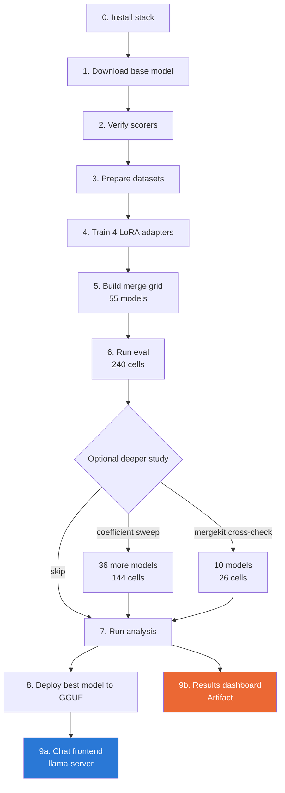

# Tutorial: Running This Project End-to-End

Step-by-step guide to reproduce the pipeline and use the two output products:
the **chat frontend** (talk to the merged model) and the **results dashboard**
(browse the study's findings).

## Pipeline flow



Stages 0–8 only need to run once. Once `deploy/*.gguf` exists, jump straight
to **Part A** below.

---

## Part A — Chat with the model (fastest path)

**Step 1.** Open a terminal in the project folder.

```
cd c:\Users\12403\Pictures\mini-project
```

**Step 2.** Start the server.

```
.\llama.cpp\build\bin\Release\llama-server.exe -m deploy\magnitude_prune__sql-math-translation-json-Q4_K_M.gguf --port 8090 --host 127.0.0.1 -c 4096
```

**Step 3.** Wait for this line in the terminal:

```
llama_server: listening on http://127.0.0.1:8090
```

**Step 4.** Open your browser to:

```
http://127.0.0.1:8090
```

**Step 5.** Type a message and press Enter. Try one of each task the model was trained on:

| Task | Try asking |
|---|---|
| SQL | "Write a SQL query to find all customers older than 30" |
| Math | "What is 45 times 12, minus 7?" |
| Translation | Paste a Tamil sentence and ask for the English translation |
| JSON | "Extract name and age as JSON from: John is 34 years old." |

**Step 6.** To stop the server, go back to the terminal and press `Ctrl+C`.

> Leave the server terminal open while you use the browser tab — closing the
> terminal ends the session.

---

## Part B — Browse the research results

**Step 1.** Open the dashboard link:

[Retention Grid](https://claude.ai/code/artifact/067b6905-1d3a-4551-bdb9-c48ba46f0863)

**Step 2.** Read the top strip — confirms every pipeline stage finished.

**Step 3.** Check the highlighted card — this is the exact model the chat
frontend in Part A is running.

**Step 4.** Scroll to the bar chart — compares the five merge methods by how
much task performance they keep after merging.

**Step 5.** Scroll to the line chart — shows performance drops as more tasks
get merged into one model.

**Step 6.** Scroll to the scatter plot — a sanity check comparing two
different merge implementations against each other.

**Step 7.** Use the table at the bottom — click any column header to sort,
use the dropdowns to filter by method or number of tasks merged.

---

## Part C — Reproduce the whole pipeline from scratch

Only needed on a new machine, or to retrain with different settings.

### 1. Install the stack

```
python -m venv .venv
.venv\Scripts\python.exe -m pip install torch --index-url https://download.pytorch.org/whl/cu124
.venv\Scripts\python.exe -m pip install transformers peft datasets accelerate bitsandbytes trl mergekit sqlglot sacrebleu jsonschema pandas numpy matplotlib seaborn scipy huggingface_hub pyyaml
```

Check it worked:

```
.venv\Scripts\python.exe -c "import torch; print(torch.cuda.is_available())"
```

Should print `True` if you have an NVIDIA GPU.

### 2. Download the base model

```
.venv\Scripts\python.exe scripts_download_model.py
```

This pins an exact model snapshot into `config.yaml` so later steps stay
reproducible.

### 3. Verify the scorers

```
.venv\Scripts\python.exe -m eval.test_scorers
```

Should print `ALL SCORER CHECKS PASSED`. Stop here and investigate if not —
nothing downstream can be trusted otherwise.

### 4. Prepare the datasets

```
.venv\Scripts\python.exe -m data.prepare
```

Downloads/generates the four task datasets into `data/processed/`.

### 5. Train the four adapters

```
.venv\Scripts\python.exe -m train.run
```

Trains sequentially: sql → math → translation → json. Takes hours on a
laptop GPU. To train one task only:

```
.venv\Scripts\python.exe -m train.run --task sql
```

### 6. Build the merge grid

```
.venv\Scripts\python.exe -m merge.build
```

Builds all 55 merged models. Takes about a minute — this step is cheap.

### 7. Run evaluation

```
.venv\Scripts\python.exe -m eval.run
```

Scores every model on every task. This is the slow step — hours, not
minutes. It resumes automatically if interrupted; just re-run the same
command.

### 8. Run the analysis

```
.venv\Scripts\python.exe -m analysis.report
```

Produces the CSVs and charts under `analysis/`.

### 9. Deploy to GGUF

```
.venv\Scripts\python.exe -m deploy.build
```

Picks the best model, converts it, and quantizes it — output lands in
`deploy/`. Requires `llama.cpp` cloned and built first (see step 10).

### 10. Build llama.cpp (one-time, only needed for steps 9 and Part A)

```
git clone --depth 1 https://github.com/ggml-org/llama.cpp.git
cmake -B llama.cpp\build -S llama.cpp -G "Visual Studio 17 2022" -A x64 -DGGML_CUDA=OFF -DLLAMA_CURL=OFF
cmake --build llama.cpp\build --config Release --target llama-quantize llama-cli llama-server
```

---

## Troubleshooting

| Problem | Fix |
|---|---|
| `couldn't bind HTTP server socket` | Port already in use — add `--port 8091` (or any free port) to the server command |
| Browser shows a blank page or download prompt | Use a real browser, not `curl` — the page is gzip-compressed and browsers handle that automatically |
| `UnicodeDecodeError` running a Python script on Windows | Prefix the command with `set PYTHONUTF8=1 &&` |
| Training/eval says "no adapter found" | Run the earlier step it depends on — `train.run` before `merge.build`, `merge.build` before `eval.run` |
| GPU not detected (`torch.cuda.is_available()` is `False`) | Reinstall torch with the CUDA index URL from step 1, not the plain `pip install torch` |
